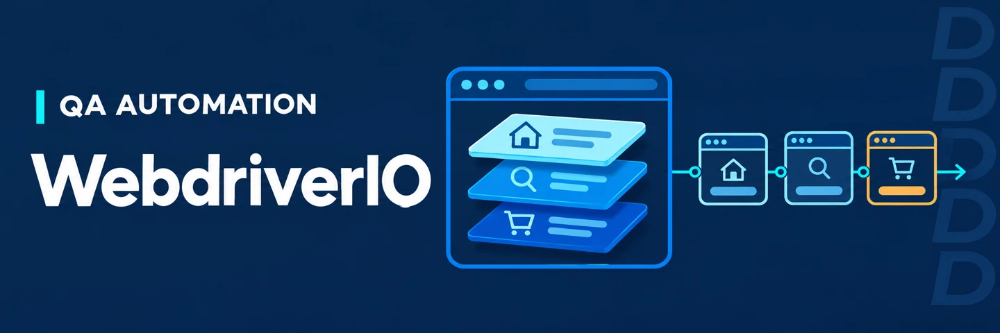
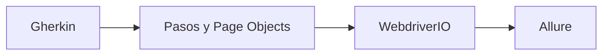

# WebdriverIO + Cucumber + Allure

Pruebas web E2E en TypeScript con WebdriverIO y Cucumber. Separa el acceso a la interfaz con Page Objects y conserva capturas por paso en Allure.

[Inicio rápido](#inicio-rápido) · [Flujo de prueba](#flujo-de-prueba) · [QA asistido por IA](#qa-asistido-por-ia) · [GitHub Actions](https://github.com/Jlaucel/TS-WebdriverIO-Cucumber/actions/workflows/qa.yml)

## Qué incluye

- **Page Objects.** Centraliza selectores e interacciones para reutilizarlos desde las definiciones de pasos.
- **Chrome headless.** WebdriverIO ejecuta la prueba en Chrome sin abrir una ventana.
- **Capturas por paso.** El hook `afterStep` adjunta al reporte una captura de la ejecución.

## Inicio rápido

Usa Node.js 24. WebdriverIO administra el driver de Chrome y puede usar una instalación local del navegador. Para abrir el reporte Allure, instala Java y configura `JAVA_HOME`.

```bash
npm ci
npm run qa:check
npm test
```

Usa `npm run report` para abrir Allure con las capturas de los pasos.

## Flujo de prueba



El escenario `QA-WDI-001` comprueba la pantalla de tráfico inusual de Google. Tiene la etiqueta `@external` porque esa respuesta depende del servicio. CI valida Gherkin y trazabilidad. [Ver los escenarios](features/google_search.feature)

| Ruta | Contenido |
| --- | --- |
| [`features/google_search.feature`](features/google_search.feature) | Escenario Gherkin de referencia. |
| [`features/step-definitions/`](features/step-definitions/) | Pasos en TypeScript. |
| [`features/pageobjects/`](features/pageobjects/) | Selectores e interacciones de la página. |
| [`wdio.conf.ts`](wdio.conf.ts) | Navegador, integración Cucumber y capturas Allure. |

## QA asistido por IA

| Skill de Codex | Cuándo usarla |
| --- | --- |
| [`$qa-design`](.agents/skills/qa-design/SKILL.md) | Diseñar escenarios BDD según criterios de aceptación y riesgo. |
| [`$qa-triage`](.agents/skills/qa-triage/SKILL.md) | Preparar un diagnóstico con los resultados y la evidencia de una ejecución. |
| [`$qa-integrations`](.agents/skills/qa-integrations/SKILL.md) | Relacionar diseños, criterios y casos con sus pruebas. |

`npm run qa:triage` resume los resultados Allure después de una ejecución. Los hooks de Codex orientan el flujo de diseño y diagnóstico. [Guía ISTQB y hooks](docs/qa.md)

Configura **Figma, Jira, Zephyr y Slack** en tu cliente local con acceso autorizado. [Guía de conexiones](docs/integraciones-qa.md)

---

**Colección QA Automation de Yunior Laucel**

[Cypress](https://github.com/Jlaucel/TS--Cypress-Cucumber) · [Playwright](https://github.com/Jlaucel/TS-Playwrigth-Cucumber) · **WebdriverIO** · [Maestro](https://github.com/Jlaucel/TS-Maestro-Cucumber) · [yuniorlaucel.com](https://yuniorlaucel.com)
